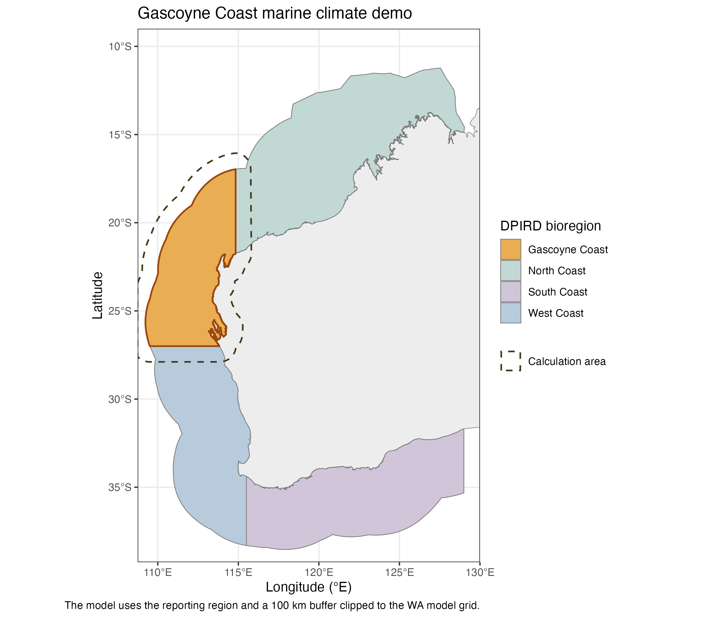
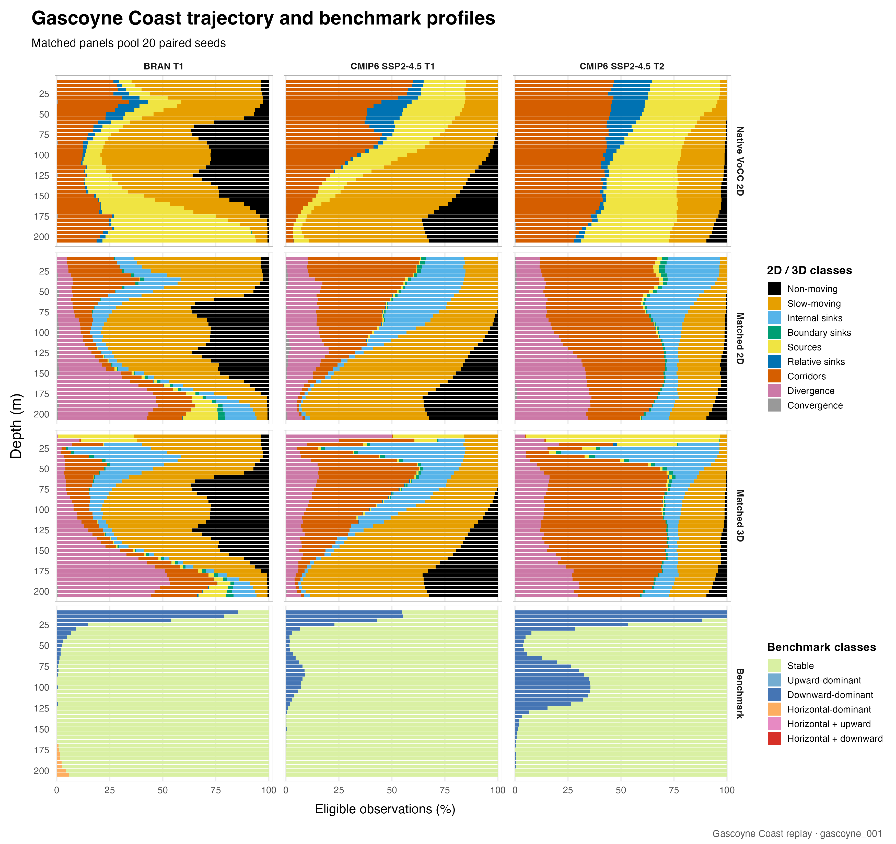
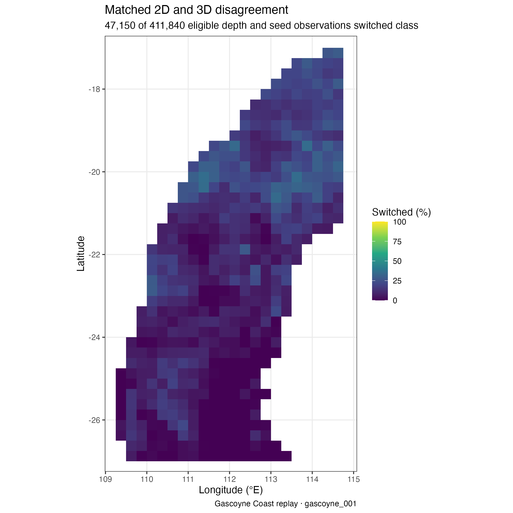

# Gascoyne Coast marine climate velocity demo

Author: Stephen Bradshaw

Email: stephen.bradshaw@dpird.wa.gov.au

This standalone demo accompanies the depth-resolved climate-velocity comparison described in **"REFERENCE PENDING"**. Climate velocity describes the pace and direction of changing thermal conditions. Most trajectory classifications are horizontal, whereas the paper tests how allowing a vertical thermal pathway changes the resulting class assignment.

The demo compares native VoCC 2D trajectories, a matched zero-vertical 2D particle control, a matched full-3D particle model, and a direct velocity-magnitude benchmark. It reports results within the DPIRD Gascoyne Coast polygon, while retaining a 100 km calculation buffer for gradients and trajectories. These outputs are method-conditional climate diagnostics; they do not demonstrate observed organism movement, refugia, or management suitability.

The headline runs cover BRAN and CNRM-CM6-1-HR for T1 (1994–2023) and CNRM-CM6-1-HR SSP2-4.5 for T2 (2024–2053). The sensitivity analysis uses BRAN T1.

  

*Figure 1. The orange polygon is the Gascoyne Coast reporting region. The dashed outline is the 100 km calculation area; the other WA marine bioregions are included for geographic context only.*

## Run in RStudio / Positron

On a fresh clone, open the demo folder as the working directory, let `.Rprofile` activate the project `renv`, and run `renv::restore()` once in the Console. Then start a fresh R session, run `scripts/00_config.R` to configure a run ID and verify the package requirements, then run `scripts/01_load_data.R` with `input_source` set to `"prepared"` for the supplied ZIPs or `"download"` for raw NetCDFs; continue in the selected order below after each `Section complete`, using a new run ID if you switch routes.

| Setting in 01 | Script order |
| --- | --- |
| `"prepared"` (default) | **00 → 01 → 03 → 04 → 05 → 06 → 07**. Skip 02. |
| `"download"` | **00 → 01 → 02 → 03 → 04 → 05 → 06 → 07**. Run 02 after all raw files pass 01. |

Use a current R release with a writable package library and demo folder. Script 00 requires at least R 4.1. The reference run used R 4.6.1 on arm64 macOS. Installing packages needs access to CRAN and GitHub. With the supplied ZIPs and packages in place, the prepared route can run offline. The raw download requires internet access to the data providers and a NetCDF-C build with NetCDF-4 and OPeNDAP support. Script 07 needs PNG graphics support.

Where CRAN binaries are unavailable, prepare your platform's R build toolchain and the native development libraries needed by `ncdf4`, `curl`, `sf`, `terra` and their dependencies. These include NetCDF-C, libcurl, GDAL, GEOS, PROJ, SQLite, UDUNITS2 and TBB. Fix any native library errors reported by the R installer, then rerun 00. [ncdf4 requirements](https://cran.r-project.org/package=ncdf4) · [sf requirements](https://cran.r-project.org/package=sf) · [terra requirements](https://cran.r-project.org/package=terra) · [units requirements](https://cran.r-project.org/package=units)

| Stage | What it does |
| --- | --- |
| [00 Set up R and configure](scripts/00_config.R) | Installs missing packages, checks the VoCC revision and defines the region, depths, time periods and run folder. |
| [01 Choose and load inputs](scripts/01_load_data.R) | Loads the two supplied WA-derived prepared ZIPs, or downloads and checks the raw regional NetCDFs and map layers. |
| [02 Prepare raw data](scripts/02_prepare_data.R) | **Download route only.** Interpolates monthly temperatures, aligns them to the NOAA OISST grid and applies a common finite-water mask. Writes 87 dated GeoTIFFs. |
| [03 Calculate velocity](scripts/03_calculate_velocity.R) | Uses annual temperature means and spatial gradients to build 12 HVoCC and VVoCC variants. |
| [04 Run native VoCC and benchmark](scripts/04_run_native_and_benchmark.R) | Classifies native horizontal trajectories and applies the direct HVoCC and VVoCC thresholds. |
| [05 Run matched models](scripts/05_run_matched_models.R) | Runs 20 paired seeds for each headline input, comparing the matched zero-vertical 2D control with the full 3D particle model. |
| [06 Run sensitivity](scripts/06_run_sensitivity.R) | Runs 37 BRAN T1 sensitivity configurations using five paired seeds each. |
| [07 Make outputs](scripts/07_make_outputs.R) | Publishes five PNGs, two result tables and a checksum manifest to `outputs/`. |

## Prepared inputs (default)

Git includes both ZIPs under `data/prepared/`. If you copy the demo manually, keep both files in that folder.

- `gascoyne_ssp245_wa_bran_noaa.zip` (55 MB) contains BRAN and NOAA temperatures, the region layers and both checksum manifests.
- `gascoyne_ssp245_wa_cmip6.zip` (97 MB) contains the CMIP6 SSP2-4.5 temperature series.

The temperature stacks come from the paper's final WA preparation step and have already been cropped to the demo's 32 × 54 calculation grid, including the buffer, on the paper's 0.25° grid. Script 01 checks the ZIP inventories and checksums, then checks dates, the common mask and the map layers before saving the 87 GeoTIFFs in `runs/<run-id>/prepared/`. Loading and checking both ZIPs took **2.9 seconds** in a clean copy on the reference Mac. Run **03 next**.

## Raw NetCDF download (optional)

With `input_source <- "download"`, script 01 creates `data/tmp/gascoyne_ssp245/` on demand and writes **386 regional `.nc` files** there from the providers’ OPeNDAP services. Once script 01 completes, run **02** to turn these native-grid files into prepared GeoTIFFs. The cache stays on disk between R sessions so interrupted downloads can resume, and Git ignores it.

| Input | Downloaded from | Files and coverage |
| --- | --- | --- |
| BRAN2020 `temp` | NCI THREDDS | 372 monthly files, January 1993–December 2023 |
| NOAA OISST v2.1 `sst` | NOAA PSL THREDDS | One monthly series, September 1981–June 2025 |
| CMIP6 `thetao` | ESGF at NCI, with the ORNL ESGF replica as a fallback | 13 five-year files from CNRM-CM6-1-HR, member `r1i1p1f2`, grid `gn`. Historical version `v20191021` and SSP2-4.5 version `v20191202` |
| Region and coastline | WA SLIP and Natural Earth | Script 01 saves the boundaries, Gascoyne polygon, calculation buffer and land to `regions.gpkg` |

Allow **45–60 minutes** and about **1 GiB** for a raw stage-01 download when the subset services are available; reruns reuse verified files and receipts.

For CMIP6 failures, script 01 retries smaller requests and matching ESGF replicas, then can fall back to a SHA-256-verified full source file (about **8.6 GB** transfer and **9 GB** temporary storage per file); set `cmip6_full_file_fallback <- FALSE` in script 00 to disallow that fallback. `sources.csv` records the source URL, dates, size, elapsed time, and checksum because live source archives, including recent NOAA months, can change.

### Working files

A fresh replay creates `runs/<run-id>/` locally. Stage 07 writes five PNGs, two result CSVs and a checksum manifest into `outputs/`.

The prepared route retains the paper's WA mask but can produce different regional values.

| Working files | Created by | Keep them to |
| --- | --- | --- |
| `prepared/` | 01 with prepared inputs, or 02 with downloaded inputs | Rebuild the downstream fields. |
| `preparation_chunks/` | 02 | Resume temperature preparation. |
| `velocity/` | 03 | Run or resume the matched models and sensitivity cases. |
| `comparators/` and `cases/` | 04–06 | Redraw or verify an existing run. Keep each seed directory intact so its checksums can pass. |
| `figures/` | 07 | Inspect the source tables or verify the published PNGs. |

Stage 07 saves an earlier display set in `figure_history/` when it replaces the published figures.

## Model procedure

1. **Set up the matched pair.** `run_matched_case()` selects the depth levels and builds a reproducible set of jittered particle starts in the valid voxels. Both members share the mask, starts and HVoCC. The matched 2D control sets VVoCC to zero. The full 3D model retains signed VVoCC.
2. **Advance the particles.** In `simulate_particle_chunk()`, each particle reads the velocity in its current voxel. A 0.5-year step advances latitude, uses the updated latitude to scale longitude, and updates depth. Positive VVoCC makes depth shallower. The baseline horizon is 10 years. A rejected baseline step ends the trajectory at the last valid voxel for tallying. The sensitivity cases can change the boundary policy or horizon.
3. **Classify the voxels.** `classify_voxels()` uses the local velocity-derived distance for Non-moving and Slow-moving classes. Ordered rules assign the remaining classes from start, end and through-flow proportions and the boundary-exposure flag.
4. **Summarise the comparison.** Count class changes in the Gascoyne reporting polygon across eligible voxels with valid levels immediately above and below. Compare independent 2D seeds to estimate seed noise. Subtract mean 2D seed noise from raw switching and report the within-case Monte Carlo interval.

Script 05 loads the bundled [`610_functions_3D_fast.R`](method/01_scripts/610_functions_3D_fast.R) from `method/01_scripts/`. Both numbered model scripts call the seed plan, time loop and classifier through `support/matched_cases.R`. The direct HVoCC/VVoCC benchmark in stage 04 uses thresholds of 20 km/year and 1 m/year and retains the sign of VVoCC. It classifies each depth independently.

### Shared code

| File | Used for |
| --- | --- |
| `support/prepared_inputs.R` | Installs the two prepared ZIPs and checks the temperature stack layout, dates and mask for both routes. |
| `support/download_netcdf.R` | Sources and checkpoints the raw NetCDFs when you select `"download"`. |
| `support/raw_data.R` | Package checks, NetCDF axes and monthly calendar checks. |
| `support/region.R` | Shared polygon masks, grid geometry and grid alignment checks. |
| `support/velocity.R` | Consistent velocity filenames and analysis-period checks. |
| `support/matched_cases.R` | Settings, paired model calls, result checks and reporting for stages 05 and 06. |
| `support/checkpoints.R` | Checksums and saving completed stages for resumption. |
| `method/` | The climate-velocity calculations, classification rules, case definitions and figure aggregations used in the study. |

The preparation, native comparator and plotting functions live in their respective numbered scripts, alongside the steps that call them.

## Time, memory and restarting

Allow roughly a day of compute for a serial run on comparable hardware. The measured reference run used R 4.6.1 on arm64 macOS. Allow **15 GiB** for a fixture and a completed run. The completed reference run occupied **11.85 GiB**.

| Processing stage | Measured compute | Peak R memory |
| --- | --- | --- |
| 02 Temperature preparation (download route only) | 18 min with parallel workers. The 386 per-file times add to 32 min. | 1,272 MiB |
| 03–04 Velocity and comparator calculations | 8 min 3 s elapsed | 779 MiB |
| 05 Headline particle models | 8 h 57 min of combined R CPU time for 60 pairs | 861 MiB |
| 06 Sensitivity particle models | 10 h 19 min of combined R CPU time for 185 pairs | 1,048 MiB |

R CPU time is summed across workers where applicable. Peak memory is per process. The reference run took **7 h 58 min elapsed** with parallel workers and laptop sleep pauses.

If interrupted, run script 00 with the same run ID and resume the interrupted stage. The stages check the completed files before reuse. Choose a new run ID when changing the input data, settings or code. A forced stop can leave a `.running` directory inside a case folder. Confirm the model process has stopped before moving that marker aside.

## Other output figures

- **02 Surface** maps BRAN HVoCC magnitude at 2.5 m and uses thinned arrows for local direction.
- **05 Sensitivity** shows raw switching minus 2D seed noise. Zero marks equality, bars show the 95% within-case Monte Carlo interval and triangles flag 2D seed noise of at least 5%.

## Data sources and attribution

The NetCDF receipts retain the source URLs, time spans and MD5 checksums. The native slice indices are stored in the NetCDF headers. The GeoPackage contains the official WA bioregions, reporting and calculation outlines, and the coastline used in the figures.

| Input | Credit and terms |
| --- | --- |
| BRAN2020 monthly temperature | Chamberlain, Oke and Fiedler (2021), *Bluelink Ocean Reanalysis – BRAN2020*, NCI. The NCI catalogue's ISO metadata for this data collection specifies CC BY 4.0. The monthly parent files point to NCI's `gb6/BRAN/BRAN2020` collection. [Dataset DOI](https://doi.org/10.25914/6009627c7af03) · [NCI source metadata](https://geonetwork.nci.org.au/geonetwork/srv/eng/xml.metadata.get?uuid=f9372_7752_2015_3718) |
| NOAA OISST v2.1 monthly SST | Data provided by NOAA Physical Sciences Laboratory, Boulder, Colorado, USA. NOAA PSL describes its government data as public domain unless otherwise marked and requests acknowledgement. The demo crops the monthly `sst.mon.mean.nc` product. [Product and citation](https://psl.noaa.gov/data/gridded/data.noaa.oisst.v2.highres.html) · [NOAA PSL data use](https://psl.noaa.gov/disclaimer/) |
| CMIP6 CNRM-CM6-1-HR | Aurore Voldoire and CNRM-CERFACS, via the Earth System Grid Federation. Monthly `Omon/thetao`, member `r1i1p1f2`, native `gn` grid. The WCRP register records CC BY 4.0 from 17 June 2022. The older CC BY-NC-SA 4.0 text in the NetCDF headers is retained as source metadata. [Licence history](https://wcrp-cmip.github.io/CMIP6_CVs/docs/CMIP6_source_id_licenses.html) · [CMIP6 terms](https://pcmdi.llnl.gov/CMIP6/TermsOfUse/TermsOfUse6-2.html) |
| WA bioregions | State of Western Australia, Department of Primary Industries and Regional Development, *DPIRD Bioregions (DPIRD-095)*, 2023. CC BY 4.0. [Dataset catalogue](https://catalogue.data.wa.gov.au/en/dataset/dpird-bioregions) |
| Western Australian coastline | Natural Earth, 1:50m cultural country boundaries, public domain. [Natural Earth terms](https://www.naturalearthdata.com/about/terms-of-use/) |

Cite the two CMIP6 experiments used in the fixture. [Historical](https://doi.org/10.22033/ESGF/CMIP6.4067) · [SSP2-4.5](https://doi.org/10.22033/ESGF/CMIP6.4190)

Retain attribution and the [CC BY 4.0 licence link](https://creativecommons.org/licenses/by/4.0/) with the relevant data. The standalone package also contains project R source under `method/`. The active native comparator calls the pinned VoCC package, which is installed separately. Confirm the project source's release terms and any notices required for the project code with the maintainers before distributing a copy.

## Reference outputs

The committed figures below are reference outputs from the earlier raw-input replay (`gascoyne_001`). Script 07 publishes figures for the input route and run ID used in a new replay.

<table>
  <tr>
    <td width="50%" valign="top">
      
      
<strong>Figure 2.</strong> Class proportions through depth for BRAN T1 and CNRM-CM6-1-HR SSP2-4.5 in T1 and T2. Rows compare native VoCC 2D, matched 2D, matched 3D, and the velocity-magnitude benchmark.

    </td>
    <td width="50%" valign="top">
      
      
<strong>Figure 3.</strong> BRAN T1 disagreement between matched 2D and 3D classifications. Each cell gives the percentage of eligible depth-by-seed observations assigned different classes.

    </td>
  </tr>
</table>
